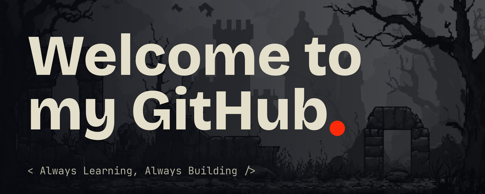

  <a href="#-about-me">🏠 About Me</a> &nbsp;&nbsp;|&nbsp;&nbsp;
  <a href="#-skills">&lt;/&gt; Skills</a> &nbsp;&nbsp;|&nbsp;&nbsp;
  <a href="#-projects">📂 Projects</a> &nbsp;&nbsp;|&nbsp;&nbsp;
  <a href="#-lets-connect">🔗 Connect</a>

<table>
<tr>
<td width="62%" valign="top">

## 👤 About Me

Hi! I'm a Informatics student who loves coding,
exploring new technologies, and building useful things.

## 🔧 Skills

</td>
<td width="38%" valign="top">

## 🔗 Let's Connect

 **GitHub** &nbsp;&nbsp;&nbsp;&nbsp;: [github.com/Alvalah22](https://github.com/Alvalah22)

 **Email** &nbsp;&nbsp;&nbsp;&nbsp;&nbsp;&nbsp;: [alvalah22@gmail.com](mailto:alvalah22@gmail.com)

 **LinkedIn** &nbsp;: [linkedin.com/in/alvalah22](https://linkedin.com/in/alvalah22)

 **YouTube** &nbsp;&nbsp;: [youtube.com/@Alvalah22](https://youtube.com/@Alvalah22)

</td>
</tr>
</table>

## 📂 Projects

| Project | Description | Tech |
| ------- | ----------- | ---- |
| [Project One](https://github.com/Alvalah22/project-one) | Short description of your first project | `Python` |
| [Project Two](https://github.com/Alvalah22/project-two) | Short description of your second project | `JavaScript` `HTML` `CSS` |
| [Project Three](https://github.com/Alvalah22/project-three) | Short description of your third project | `Java` `MySQL` |

---

<code>— Keep Coding, Keep Growing —</code>

